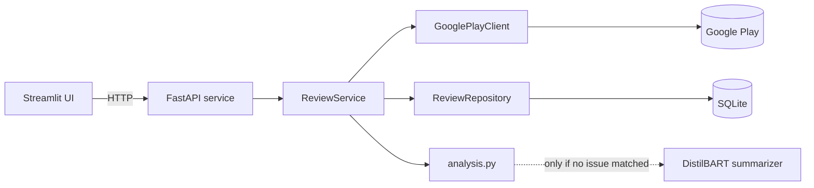

# Play Store Review Analyzer

[](https://github.com/Dreem-R/PlayStore-review-analyzer/actions/workflows/ci.yml)

Pulls recent Google Play reviews for any app, stores them, and reports what users are unhappy about: a sentiment breakdown, the most-mentioned problem areas with example complaints, and a suggested fix for each.

It is split into a FastAPI service that owns scraping, storage and analysis, and a Streamlit frontend that only talks to the API.

## Architecture



- **Sync and analyze are separate steps.** `POST /apps/{id}/sync` fetches the newest reviews and upserts them. Analysis reads only from the database, so it's fast, repeatable, and works across syncs as the history grows.
- **Upserts, not appends.** Reviews are keyed by their Play Store ID. Re-syncing reports how many were new and refreshes reviews the user edited.
- **The ML dependency is optional.** torch and transformers are in an `ml` extra. Without them the API still runs and just skips the summary fallback. CI runs without them.
- **The scraper sits behind a `ReviewSource` protocol,** so tests use an in-memory fake and never hit the network.

## How the analysis works

- **Sentiment** is taken from the star rating (4–5 positive, 3 neutral, 1–2 negative).
- **Issues**: negative reviews are split into sentences and matched against keyword sets for six categories (interface, performance, security, size, ads, login). Matching is on whole words, so "ui" doesn't match "build". Categories are ranked by mentions, and each comes with example sentences and a suggested fix.
- **Fallback**: if no category matches, a [DistilBART](https://huggingface.co/sshleifer/distilbart-cnn-6-6) model summarizes the negative reviews instead.

## API

| Method | Path | Description |
|---|---|---|
| `GET` | `/apps/search?q=` | Search the Play Store |
| `POST` | `/apps/{app_id}/sync?count=` | Fetch the newest reviews (up to 1000) and store them |
| `GET` | `/apps/{app_id}/reviews?limit=&offset=` | Stored reviews, newest first |
| `GET` | `/apps/{app_id}/analysis?limit=` | Analysis of the most recent `limit` stored reviews |
| `GET` | `/apps/{app_id}/export.csv` | Stored reviews as CSV |
| `GET` | `/health` | Liveness check |

Interactive docs are served at `/docs` when the API is running.

```bash
curl -X POST "localhost:8000/apps/com.spotify.music/sync?count=200"
curl "localhost:8000/apps/com.spotify.music/analysis"
```

## Running it

With Docker:

```bash
docker compose up --build
```

The UI is at http://localhost:8501 and the API at http://localhost:8000/docs. Reviews and the downloaded model are kept in Docker volumes.

Locally with [uv](https://docs.astral.sh/uv/):

```bash
uv sync --all-extras
uv run uvicorn review_analyzer.api:create_app --factory --reload
uv run streamlit run src/review_analyzer/ui/app.py   # in a second terminal
```

Settings are read from `REVIEW_ANALYZER_*` environment variables (see [.env.example](.env.example)). By default, data goes to `data/reviews.db`.

## Development

```bash
uv sync --extra ui --group dev
uv run pytest
uv run ruff check . && uv run ruff format --check .
uv run mypy
```

CI runs all of these on every push and pull request, and also builds the Docker image and checks that the API starts.

```
src/review_analyzer/
  api.py          FastAPI app and routes
  service.py      sync / list / analyze use cases
  scraper.py      Play Store client behind the ReviewSource protocol
  storage.py      SQLAlchemy model and repository
  analysis.py     sentiment and issue detection
  summarizer.py   lazily loaded DistilBART summarizer
  ui/app.py       Streamlit frontend
tests/            unit and API tests with a fake review source
```

## Limitations

- Sentiment comes from star ratings, so it misses mismatches like a 5-star review complaining about crashes.
- Issue categories are a fixed keyword list and only cover English reviews from the US store.
- google-play-scraper is unofficial. Google can rate-limit or change the page format at any time. The top "featured" search result has no app ID and is skipped.

## License

[MIT](LICENSE)
