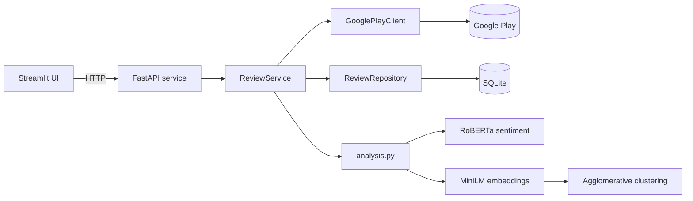

# Play Store Review Analyzer

[](https://github.com/Dreem-R/PlayStore-review-analyzer/actions/workflows/ci.yml)

Pulls recent Google Play reviews for any app, stores them, and reports what users are unhappy about:

- **Recurring complaints**, found by clustering complaint sentences by meaning rather than from a fixed keyword list.
- **Sentiment from the review text**, compared against the star rating.
- **Complaints hidden in high ratings**: 4–5 star reviews whose text is clearly negative.
- **How each release changed things**: negative share and issue counts per app version.

It is split into a FastAPI service that owns scraping, storage and analysis, and a Streamlit frontend that only talks to the API.

## Architecture



- **Sync and analyze are separate steps.** `POST /apps/{id}/sync` fetches the newest reviews and upserts them. Analysis reads only from the database, so it's repeatable and covers more history as you sync more.
- **Sentiment is scored once and stored.** Scoring happens on the first analysis rather than during sync, so syncs stay fast. Reviews stored before the model was installed get scored too. Editing a review clears its score.
- **The ML dependency is optional.** torch and transformers are in an `ml` extra. Without them, analysis falls back to rating-based sentiment and keyword categories. CI runs without them: the models sit behind small `SentimentModel` and `Embedder` protocols, and the tests use deterministic fakes.
- **Schema changes go through Alembic migrations,** applied on startup. Databases created before migrations existed are detected and upgraded in place, and a test checks that the migrations match the ORM models.

## How the analysis works

1. **Sentiment.** Each review is labeled positive, neutral or negative by [`twitter-roberta-base-sentiment-latest`](https://huggingface.co/cardiffnlp/twitter-roberta-base-sentiment-latest). The star rating is kept alongside it.
2. **Complaints** are reviews rated 1–2 stars or with negative text. They're split into sentences, and sentences the model reads as positive are dropped, so "Love the music, but…" only keeps the "but".
3. **Clustering.** Sentences are embedded with [`all-MiniLM-L6-v2`](https://huggingface.co/sentence-transformers/all-MiniLM-L6-v2) and grouped with agglomerative clustering (cosine distance 0.6). The number of issues falls out of the data instead of being fixed. Issues raised by a single review are dropped.
4. **Labeling.** Each cluster is labeled with its most distinctive terms using class-based TF-IDF, ignoring the app's own name. The examples shown are the sentences closest to the cluster's centroid. If most of a cluster's sentences fall into a known category (ads, performance, login, pricing…), it gets that category's suggested fix.
5. **Versions.** Reviews are grouped by the app version they were written on (versions with at least 5 reviews), ordered numerically, so 3.10 comes after 3.9.

The 0.6 distance threshold was picked by comparing clusters on 500 live Spotify reviews. At 0.5, ads complaints split into near-duplicate groups. At 0.7, 42% of complaints merged into one catch-all group.

### What the text model adds

On 1,500 recent reviews (500 each for Duolingo, Spotify and WhatsApp, October 2026):

| | Duolingo | Spotify | WhatsApp | All |
|---|---|---|---|---|
| Star rating and text sentiment agree | 81% | 77% | 58% | 72% |
| 4–5 star reviews with negative text | 1.8% | 5.3% | 5.6% | 4.1% |

Those 4–5 star complaints are what the rating-only version missed, for example *"EPIC as a PAID app, POOR as a FREE app. To many adds."* (5 stars). WhatsApp's low agreement mostly comes from very short or non-English reviews, which the model calls neutral.

## API

| Method | Path | Description |
|---|---|---|
| `GET` | `/apps/search?q=` | Search the Play Store |
| `GET` | `/apps/{app_id}` | Look up one app by package name |
| `POST` | `/apps/{app_id}/sync?count=` | Fetch the newest reviews (up to 1000) and store them |
| `GET` | `/apps/{app_id}/reviews?limit=&offset=` | Stored reviews, newest first, with text sentiment once scored |
| `GET` | `/apps/{app_id}/analysis?limit=` | Analysis of the most recent `limit` stored reviews |
| `GET` | `/apps/{app_id}/export.csv` | Stored reviews as CSV |
| `GET` | `/health` | Liveness check |

Interactive docs are served at `/docs` when the API is running.

```bash
curl -X POST "localhost:8000/apps/com.spotify.music/sync?count=500"
curl "localhost:8000/apps/com.spotify.music/analysis?limit=500"
```

## Running it

With Docker:

```bash
docker compose up --build
```

The UI is at http://localhost:8501 and the API at http://localhost:8000/docs. The first analysis downloads the two models (about 600 MB) into a Docker volume.

Locally with [uv](https://docs.astral.sh/uv/):

```bash
uv sync --all-extras
uv run uvicorn review_analyzer.api:create_app --factory --reload
uv run streamlit run src/review_analyzer/ui/app.py   # in a second terminal
```

In the UI you can search by name, or paste a package name or Play Store link.

Settings are read from `REVIEW_ANALYZER_*` environment variables (see [.env.example](.env.example)). By default, data goes to `data/reviews.db`.

## Development

```bash
uv sync --extra ui --group dev
uv run pytest
uv run ruff check . && uv run ruff format --check .
uv run mypy
```

CI runs all of these on every push and pull request, and also builds the Docker image and checks that the API starts.

To change the schema, edit the models in `storage.py` and add a migration:

```bash
uv run alembic revision -m "describe the change"
```

```
src/review_analyzer/
  api.py          FastAPI app and routes
  service.py      sync / lookup / analyze use cases; scores and stores sentiment
  scraper.py      Play Store client behind the ReviewSource protocol
  storage.py      SQLAlchemy model, repository, migration runner
  migrations/     Alembic migrations
  analysis.py     complaints, issues, mismatches, version stats
  clustering.py   agglomerative clustering and c-TF-IDF labels
  categories.py   known issue categories and suggested fixes
  ml.py           lazily loaded sentiment and embedding models
  ui/app.py       Streamlit frontend
tests/            unit, API and migration tests with fake models and a fake review source
```

## Limitations

- Text sentiment comes from a general-purpose model, not one trained on app reviews. It struggles with sarcasm, very short reviews and non-English text.
- The first analysis of 500 new reviews takes 30–40 seconds on CPU, most of it sentiment scoring. Sentence-level scores and embeddings aren't cached yet, so later analyses still take around 15 seconds.
- Only English reviews from the US store are requested, but some non-English reviews come through anyway.
- google-play-scraper is unofficial and returns the top "featured" search result without an ID. The client recovers it from the search page, which will break if Google changes that page.

## License

[MIT](LICENSE)
